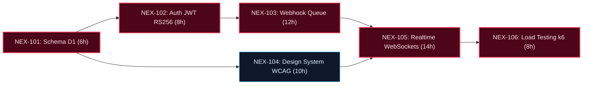

# 🔀 NexusFlow — DAG Task Dependency & Agile Execution Engine


**NexusFlow** é um workspace de engenharia ágil inspirado no Linear.app que modela tarefas como um **Grafo Acíclico Direcionado (DAG)**. Ao contrário de quadros Kanban tradicionais onde cartões são listas passivas, o NexusFlow executa em tempo real o **Algoritmo de Ordenação Topológica de Kahn** combinado com **Programação Dinâmica para o Método do Caminho Crítico (Critical Path Method - CPM)**.

---

## 🧠 Algoritmos & Estruturas de Dados Aplicados

- **🕸️ Ordenação Topológica de Kahn & Caminho Crítico (`src/engine/dagScheduler.ts`)**:
  - Calcula as janelas de agendamento *Earliest Start ($ES$)* e *Earliest Finish ($EF$)* de cada tarefa com complexidade linear $\mathcal{O}(V + E)$.
  - Reconstrói automaticamente a cadeia gargalo (**Caminho Crítico**) cujo atraso impacta diretamente a data de entrega da sprint.
- **🛡️ Detecção Preventiva de Ciclos via DFS**:
  - Antes de inserir qualquer aresta de pré-requisito ($u \to v$) no grafo, o motor executa uma Busca em Profundidade (*Depth-First Search*) para impedir *deadlocks* e dependências circulares.
- **🔒 Guardião de Transição de Estado (DAG Gatekeeper)**:
  - Impede que uma tarefa avance para `DONE` caso qualquer uma de suas dependências diretas no grafo ainda não tenha sido concluída.
- **⏪ Máquina de Estados Imutável com Undo / Redo**:
  - Histórico estruturado em pilhas (`past`, `present`, `future`) permitindo reverter ou refazer movimentações e adições no grafo instantaneamente.

---

## 📊 Visualização do Grafo de Engenharia (DAG)


> **Caminho Crítico Calculado**: `NEX-101` → `NEX-102` → `NEX-103` → `NEX-105` → `NEX-106` (**48 horas úteis**).

---

## 🚀 Como Executar Localmente

```bash
# 1. Instalar dependências
npm install

# 2. Executar testes unitários de Teoria dos Grafos (CPM, DFS Cycle Detection e Undo/Redo)
npm test

# 3. Iniciar ambiente de desenvolvimento interativo
npm run dev

# 4. Gerar build de produção
npm run build
```

---

## 👨‍💻 Autor

Desenvolvido por **Ícaro Costa** — [ICARUS Soluções Digitais](https://github.com/IcaroCos19)  
- 💼 LinkedIn: [linkedin.com/in/icaro-costa-3a335627b](https://www.linkedin.com/in/icaro-costa-3a335627b)
- 📧 E-mail: `icarkz219@gmail.com`
